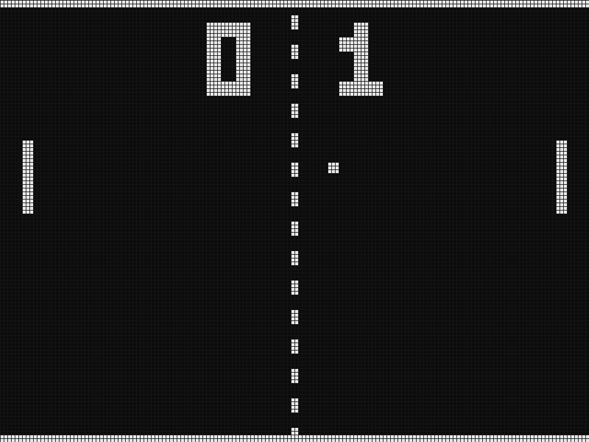

# mistang-core-pong

Pong for MiSTang (Sipeed Tang Nano 20K). Written from scratch.

- `rtl/pong_game.sv`: game logic (ball, two paddles, score, serve). S1/S2 move the left paddle; when idle for 3 s, or for the right paddle, a simple AI plays.
- `rtl/pong_pixel.sv`: monochrome playfield, 160x120, with a 3x5 score font.
- `rtl/top/pong_top.sv`: 720p60 HDMI (6x scale), UART screenshot stream.
- `tools/refpong.py`: independent reference model. `./test.sh` runs 900 game ticks in iverilog and compares the complete frame.
- `build.sh`: yosys + nextpnr + gowin_pack. Timing: pixel clock 101 MHz (needs 74.25), game 34 MHz (needs 27).

Status: logic and the UART stream are verified in simulation. Board screenshot: pending.
